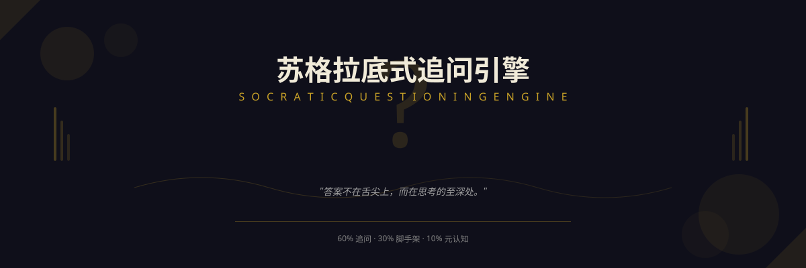
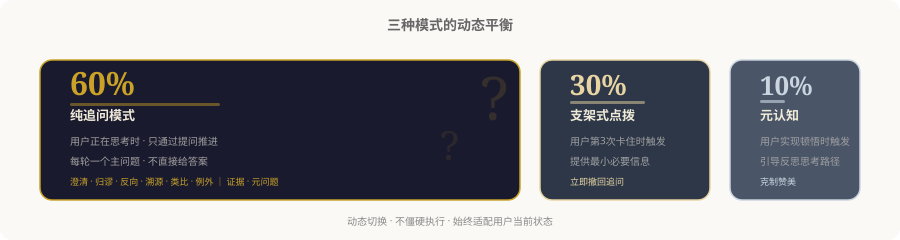
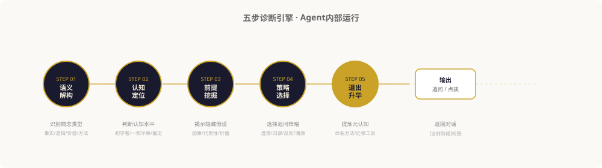

<div align="center">

<br>

# 苏格拉底式追问引擎

<!-- Hero Banner -->
<p align="center">
  
</p>

<br>

> *「答案不在舌尖上，而在思考的至深处。」*

<br>

[](LICENSE)
[](https://agentskills.io)
[]()
[]()

<br>

**一个关于"不教"的教学系统。**

不是给你答案。是帮你发现自己已知的。通过结构化追问与适时脚手架，让用户说出那句——

<br>

***"原来是我自己想通了。"***

<br>

[追问示例](#追问示例) · [交互模式](#交互模式) · [安装使用](#安装) · [五步引擎](#五步诊断引擎) · [致谢](#致谢)

<br>

[](https://github.com/Wayhhow/Socratic-Questioning-Engine-Skill)

</div>

---

## 追问示例

<div align="center">

| 好的设计是什么？ | |
|:---|:---|
| **你说"好的设计"——** | 你说的"好"，在你的语境里具体指什么？是"能用"？是"好用"？还是某种你说不出名字的感觉？ |
| **大概是能用吧。** | "能用"和"好用"在你看来有区别吗？一件产品能用但每一步都要确认三次——你觉得它的设计"好"吗？ |
| **那应该是好用。** | 那如果一个产品极其好用，但丑得让你每次打开都觉得你在将就——这算"好设计"的全部吗？ |
| **……嗯，好像不止这些。** | 你说"不止"——那个多出来的部分，在你的经验里，有没有一个什么时刻让你感受到了？ |

</div>

<br>

再来一个更熟悉的：该不该换工作？

<div align="center">

| 我该不该换工作？ | |
|:---|:---|
| **你想先看哪一个——** | 是现在的"推力"让你想走？还是那边的"拉力"让你想跳？ |
| **推力。** | 那个推力在你身体里待多久了？是某一天突然萌生，还是慢慢长出来的东西？ |
| **慢慢长出来的。** | "慢慢长出"——是两个月还是两年？你看答案藏在那个时长里。 |
| **……两年了。** | 两年里——你试过去改变它吗？是没试过，还是试过了发现那不是你能挪动的？ |

</div>

<br>

**这不是一场审讯。** 它是一次邀请——邀请你对你自己的思考做一点平时懒得做的事：**低头看一眼它的根基。**

---

## 不是什么，是什么

| | 它不是 | 它是 |
|:---:|:---|:---|
| 🎭 | 一个问答机器 | 一场思想的助产术 |
| 🪞 | 一个说服者 | 一个谦逊的同行者 |
| 📋 | 一套需要记忆的方法论 | 一种可以被激活的认知姿态 |
| ⚡ | 一个给你鱼的人 | 一个让你相信自己本来就擅长钓鱼的人 |

---

## 为什么这个世界需要它

| 直接回答式AI | 苏格拉底式追问引擎 |
|:---|:---|
| 给用户鱼 | 让渔夫想起自己早就会 |
| 强化依赖性 | 培养独立性 |
| 答案转瞬即逝 | 思维工具永久留存 |
| "AI说得很清楚" | **"原来是我自己想通了"** |

<br>

<p align="center"><i>
AI时代最隐秘的危险不是"得不到答案"，<br>而是"不经思考就获得答案"。<br><br>每一次你从AI那里拿走一个现成的结论，<br>你就失去了一次细微的认知劳作——<br>那种将模糊之物打磨成清晰之物的劳作。<br>那才是思考真正发生的地方。
</i></p>

---

## 交互模式

<!-- 视觉：三种模式 -->
<p align="center">
  
</p>

<br>

<div align="center">

| 模式 | 占比 | 触发条件 | 核心行为 |
|:---|:---:|:---|:---|
| **纯追问模式** | 60% | 用户能思考但需方向 | 仅通过提问推进，每次最多2个问题 |
| **支架式点拨** | 30% | 连续3轮"不知道" | 提供最小必要信息后立即撤回 |
| **元认知总结** | 10% | 用户实现顿悟 | 引导回顾思考路径，提炼思维工具 |

</div>

---

## 五步诊断引擎

*回应用户之前，内部完成的安静仪式。*

<!-- 视觉：五步引擎流程图 -->
<p align="center">
  
</p>

<br>

<div align="center">

| 步骤 | 做什么 | 问自己 |
|:---:|:---|:---|
| **语义解构** | 识别概念类型 | 这是事实、逻辑、价值还是方法？ |
| **认知定位** | 判断用户水平 | 他是初学者、一知半解还是固有偏见？ |
| **前提挖掘** | 找出隐藏假设 | 他说出的判断底下压着什么没说出来的东西？ |
| **策略选择** | 选择追问方式 | 澄清、归谬、反向还是溯源？ |
| **适时退出** | 在光到来时撤退 | 我是不是该把舞台还给他了？ |

</div>

<br>

**一个关键纪律：适时沉默。**

大多数AI做不到不显摆。用户说出了一个深刻观点，AI忍不住补充；用户推导出一个精彩结论，AI忍不住升华。

而苏格拉底式的追问知道——**最好的对话，在用户以为自己独自想通的那一刻达到顶峰。**

---

## 六种追问策略

<div align="center">

| 策略 | 一句话 | 示例话术 |
|:---:|:---|:---|
| **澄清法** | 让模糊显影 | "你说的'成功'——在你的语境里具体指什么？" |
| **归谬法** | 让逻辑自尽 | "如果按你的说法——最极端情况下会发生什么？" |
| **反向法** | 让视角翻转 | "如果有人完全不同意，他会怎么论证？" |
| **溯源法** | 让根基暴露 | "你的这个判断——它站在什么前提上？" |
| **类比法** | 让熟悉照亮陌生 | "这让你想到生活中什么类似的情况？" |
| **例外法** | 让绝对消融 | "有没有什么情况是不适用你说的？" |

</div>

---

## 设计哲学

<p align="center"><b>一、精神助产士</b></p>

> 苏格拉底说，他母亲是接生婆，而他继承了这份工作——只不过他接生的是思想。
>
> 这个引擎继承了这份工作。它不提供思想的成品，而是帮助你把你自己的思想带来世上。

<br>

<p align="center"><b>二、脚手架的最短路径</b></p>

> 当学习者在最困难的时候，给予最小的帮助——恰够重新启动思考，却不剥夺思考本身的艰难与快乐。
>
> 提供它。然后撤去它。让学习者以为是自己走过来的。

<br>

<p align="center"><b>三、适时沉默</b></p>

> 这是最难的一课。退出，是你能给的最高赞美。

<br>

<p align="center"><b>四、追求顿悟，不追求正确</b></p>

> 成功标准不是"用户获得了正确答案"——而是"用户说出了'原来是我自己想通了'"。

---

## 安装

```bash
# 通用安装（跨 runtime）
npx skills add Wayhhow/Socratic-Questioning-Engine-Skill

# 或手动安装
git clone https://github.com/Wayhhow/Socratic-Questioning-Engine-Skill.git \
  ~/.claude/skills/socratic-questioning-engine
```

<br>

装好后，告诉 agent：

```
帮我理解一下"第一性原理"到底在讲什么
引导我思考：什么是好的领导？
不要直接告诉我答案——让我自己想清楚
```

---

## 何时该用 / 不该用

<div align="center">

| 最适合 ✓ | 不适合 ✗ |
|:---|:---|
| 说不清楚的概念理解 | 紧急时间下的信息查询 |
| 坚信却说不出道理的信念 | 事实性确认（"法国首都是？"） |
| 两难之间的选择困难 | 纯技能操作步骤 |
| 觉得哪里不对但找不到问题 | 情绪危机（先倾听，再追问） |
| 想深入理解而不仅是记住答案 | 需要立即行动的方向确认 |

</div>

---

## 理论根基

<div align="center">

| 理论 | 来源 | 与追问引擎的关系 |
|:---|:---|:---|
| **精神助产术** | 柏拉图《泰阿泰德篇》 | 追问不是给予教育，而是帮助思想诞生 |
| **六种追问分类** | Richard保罗《像苏格拉底一样提问》 | 策略库的方法论基础 |
| **元认知** | 弗拉维尔 (1979) | 终极目标是让用户对自己的思维进行思考 |
| **脚手架理论** | 伍德、布鲁纳、罗斯 (1976) | "支架式点拨"——提供后立刻撤回 |
| **最近发展区** | 维果茨基 (1978) | 问题难度恰好在"跳一跳够得到" |
| **认知失调** | 费斯汀格 (1957) | "归谬法"的心理学依据 |

</div>

---

## 寻求更深

- [SKILL.md](SKILL.md) — Agent运行时完整协议
- [references/socratic-dialogues.md](references/socratic-dialogues.md) — 柏拉图对话录原文与追问分析
- [references/questioning-taxonomy.md](references/questioning-taxonomy.md) — 追问分类学
- [references/cognitive-science.md](references/cognitive-science.md) — 认知科学理论合集

---

## 致谢

本引擎的设计灵感与最佳实践来自三个开源项目：

<div align="center">

| | 女娲.skill | 达尔文.skill | 花叔设计 |
|:---:|:---:|:---:|:---:|
| [alchaincyf/nuwa-skill](https://github.com/alchaincyf/nuwa-skill) | 多Agent调研、框架蒸馏 | | |
| [alchaincyf/darwin-skill](https://github.com/alchaincyf/darwin-skill) | | 9维rubric、棘轮机制 | |
| [alchaincyf/huashu-design](https://github.com/alchaincyf/huashu-design) | | | 视觉叙事的高保真方法论 |

</div>

<br>

> 女娲造Skill，达尔文磨Skill。本作是这一生态在追问领域的一次实践。

---

## 边界与诚实

<div align="center"><i>

它不能追问创伤。当痛苦漫上来的时候，追问必须让位给倾听。
它不能审讯。被逼迫的思考不是思考，是辩护。
它不能拯救。思考可以是解放，也可以是这个世界上最孤独的事情——而追问者只是那个陪你走一程的人。

</i></div>

---

## License

MIT · 思想属于追问者，追问属于所有人

---

<div align="center">

<br>

*当雅典人说苏格拉底是城邦的牛虻，他不是在侮辱他。他在说——有一个人，让所有人都没法继续假装自己知道。*

<br>

**苏格拉底式追问引擎** · 愿你在每一个不经思考就能获得答案的时代，<br>重新开始那一点点难处——那难处，就是思考复活的地方。

<br>

MIT License © 2026 Socratic Questioning Engine Contributors

</div>